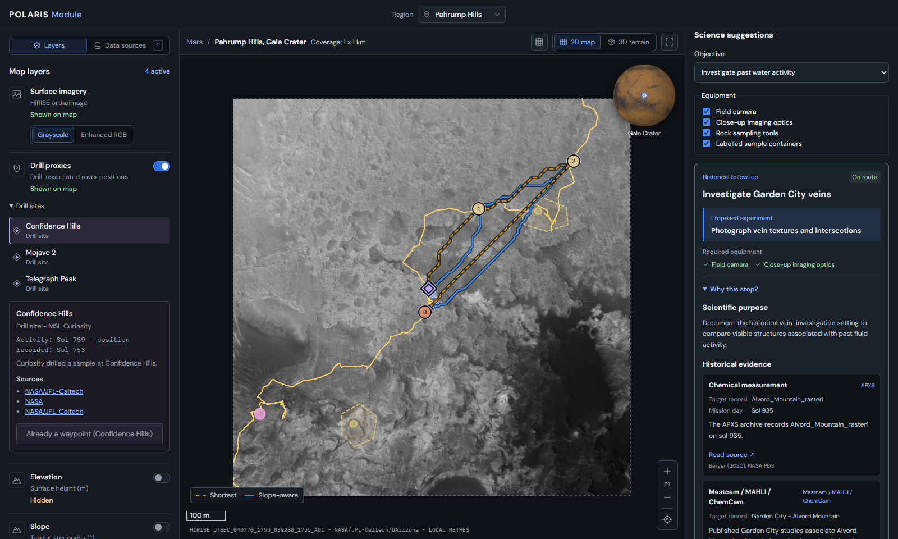
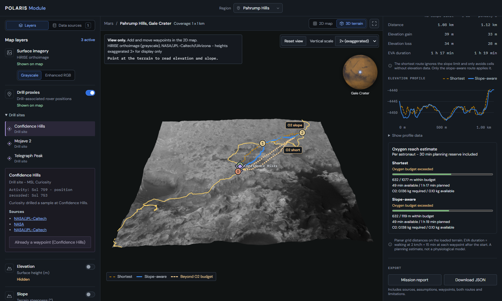
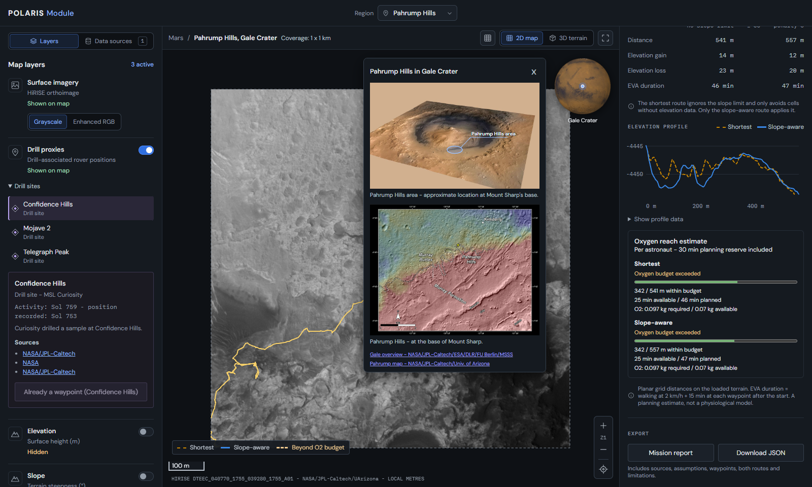
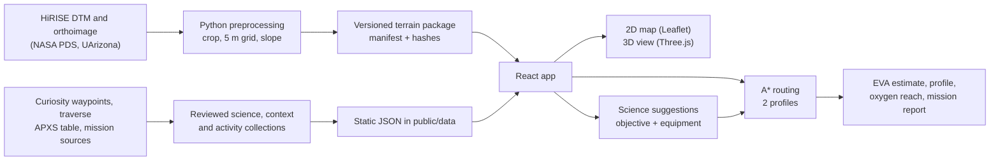

# POLARIS Module

**A Mars EVA route planner built on real HiRISE terrain.**
Plan a walking traverse across a 1 × 1 km patch of Gale Crater, compare a
shortest route with a slope-aware one, add science activities backed by
Curiosity's findings, check how far an astronaut's oxygen lasts along each
route, and export the plan as a mission report.

Built for the *Interplanetary Survival Guide: Martian Map* challenge of the
2026 NASA Space Apps Challenge. Prototype, not an operational navigation or
safety tool.

**[Try the live demo](https://hanaznable.github.io/polaris-module/)**: it runs
in your browser, with nothing to install.


## The problem

When astronauts explore Mars on foot, every EVA is limited by time, terrain and
what is worth studying. A planner has to answer three questions together:

- **Where can we walk?** Steep and unmapped ground constrains the route.
- **Where should we go?** Stops should connect to real science, not guesses.
- **How long will it take?** Distance, climb and time at each stop add up.

Mission data that answers these questions exists, but it is spread across
orbital terrain models, rover archives and science papers, in different
coordinate systems. POLARIS Module brings them onto one map for one site.

## What it does

| | |
| --- | --- |
| **Real terrain** | 1 × 1 km of Pahrump Hills, Gale Crater: HiRISE elevation, slope and orbital imagery on a 5 m planning grid. |
| **Two route options** | A* routing between ordered waypoints. *Shortest* finds the shortest path over terrain with data. *Slope-aware* refuses cells steeper than your slope limit and prefers gentler ground. |
| **Science on the map** | Curiosity drill sites, APXS chemistry measurements, the historical rover traverse and a published mineral finding, each with its sources. Add them to the route as waypoints. |
| **Science suggestions** | Pick an objective (rock textures, past water activity or mineral diversity) and the equipment you carry. The Science tab suggests 14 sourced activities: photography and sample-context stops, two orbital imaging candidates and four proposed rock-chip samples. Each card explains why the stop matters and links its evidence; one click adds it to the route. |
| **EVA estimate** | Distance, elevation gain and loss, an elevation profile and an estimated duration from your walking speed and time per stop. Optional return to start. |
| **Oxygen reach** | Set the usable oxygen each astronaut carries (default 0.54 kg, the EVA suit's primary supply). At NASA's Mars closed-loop rate of 0.076 kg per hour, with a 30-minute reserve held back, the planner shows how far each route gets before the budget runs out: an O2 marker at that point and amber dashes beyond it, in 2D and 3D. |
| **Where on Mars** | A globe in the map corner shows where Gale Crater is on Mars. Click it to see where Pahrump Hills sits in Gale Crater, on two NASA context images. |
| **3D terrain view** | The same terrain, imagery, routes and markers in 3D, at true vertical scale by default. |
| **Missions and reports** | Save named missions in the browser, export or import them as JSON, and export a printable or JSON mission report with sources, assumptions and limitations. Missions and reports keep the chosen science activities and their evidence, and the oxygen estimate. New missions use format v3, which also keeps the oxygen setting; v1 and v2 files still open. The **Info** tab shows a mission brief: the area, the plan, its objectives and the equipment it needs. |







## Try it

**Live demo:** <https://hanaznable.github.io/polaris-module/>. It is published
from `main` with GitHub Pages and needs nothing installed. The walkthrough below
applies there too.

To run it on your own computer:

```sh
npm ci
npm run dev
```

Open the local URL Vite prints. The repository includes the processed data, so
the app needs no Python, GIS software or NASA downloads. On Windows PowerShell
with script execution disabled, use `npm.cmd ci` and `npm.cmd run dev`.

To serve the production build, the same files a web host would publish, run
`npm run build` and then `npm run preview`. The build uses relative paths, so
the `dist/` folder also works from any sub-folder of a static host. The live demo
is published by the manual workflow in
[`.github/workflows/pages.yml`](.github/workflows/pages.yml) (Actions tab, "Run
workflow"); it is redeployed only when someone runs it.

**Two-minute walkthrough**

1. The app opens on **Gale Crater - Pahrump Hills**. The scale bar shows
   distance; the grid button in the map toolbar adds a metric grid with local
   east/north labels. Click the **Gale Crater** globe in the map corner to see
   where the site is.
2. In the left panel, open **Drill sites** under **Drill proxies**, select
   **Confidence Hills** and choose **Add as waypoint**. Its card shows the drill
   sols and sources.
3. Choose **Add waypoints** and click two more points on the map.
4. Compare **Shortest** (dashed) and **Slope-aware** (solid). Move the
   **Max slope** slider and watch the slope-aware route change, or fail with
   a reason. The planner notes that only the slope-aware route applies the limit.
   Then lower the **Oxygen tank** slider until an **O2** marker appears: the
   route turns to amber dashes where the oxygen budget runs out, and the
   **Oxygen reach estimate** says how many metres are within budget.
5. Open the **Science** tab. Choose the objective **Investigate past water
   activity**, tick the equipment you carry, open **Why this stop?** on a card
   and choose **Add to route**. A card that needs equipment you have not ticked
   shows it as missing and cannot be added.
6. Turn on **Historical traverse**, **APXS observations** or **Science
   missions** in the left panel to see the evidence on the map.
7. Switch to **3D terrain** and orbit around the route.
8. Open the **Missions** tab to save the plan, or choose **Mission report** to
   print it.

## How it works



- **Data preparation (Python).** The HiRISE terrain model is cropped to a
  1000 × 1000 m area and resampled to a 200 × 200 grid of 5 m cells. Elevation
  is the area-weighted mean of the source pixels. Slope is computed at the
  source's 1 m resolution (Horn method) and the steepest value in each 5 m cell
  is kept, so the grid never hides a steep patch.
- **Contracts.** Terrain, science targets, science activities, context layers
  and imagery are separate, versioned files with SHA-256 hashes. Each one names the terrain
  package it was prepared for, and the app validates it and refuses one made
  for a different package. The context layers and the colour image also check
  the exact terrain version by hash.
- **Routing (TypeScript).** A* on the 5 m grid with 8-neighbour moves and no
  corner cutting. Cells without data are never crossed. When a leg is
  impossible, the planner says why instead of relaxing the limits.
- **Science suggestions.** Activities are filtered by objective, and one can
  be added only when its required equipment is ticked. Activities at the same
  place share one route stop, so the time per stop is counted once. Removing an
  activity removes its stop only if nothing else uses it. Routing costs and the
  EVA arithmetic do not change.
- **Oxygen reach.** A constant-rate mass balance per astronaut: oxygen
  needed = 0.076 kg/h × (walking time + stop time + 30 min reserve). The
  planner walks each route in order at your walking speed, uses up time at
  each stop, and marks the point where the budget runs out. Return to start
  includes the return leg. The tank setting never changes the route itself.
  Method and sources: [oxygen budget](docs/eva/oxygen-budget.md).
- **Display.** Leaflet shows the 2D map in local metres. Three.js shows the
  terrain in 3D and loads only when that view is opened.
- **No backend.** Everything runs in the browser from static files. Missions
  are saved in the browser's local storage.

## Data sources

| Data | Source | Used for |
| --- | --- | --- |
| Terrain model | HiRISE DTM `DTEEC_040770_1755_039280_1755_A01` ([product page](https://www.uahirise.org/dtm/dtm.php?ID=ESP_040770_1755)) | Elevation and slope grids |
| Grayscale image | HiRISE orthoimage `ESP_039280_1755_RED_C_02_ORTHO`, from the same DTM product | 2D and 3D basemap |
| Colour image | HiRISE `ESP_039280_1755_MRGB`, acquired 2014-12-13 ([observation](https://www.uahirise.org/ESP_039280_1755)) | Optional enhanced RGB basemap |
| Rover positions and traverse | NASA MMGIS Curiosity layers: [`MSL_waypoints.json`](https://mars.nasa.gov/mmgis-maps/MSL/Layers/json/MSL_waypoints.json), [`MSL_traverse.json`](https://mars.nasa.gov/mmgis-maps/MSL/Layers/json/MSL_traverse.json) | Drill-site positions, historical traverse |
| Drill activities | [NASA presentation (2020), slide 5](https://assets.science.nasa.gov/content/dam/science/cds/researchers/nac/pac/2020/06-Meyer-PAC-Mars_Science_8-2020_v9_Tagged.pdf) and [JPL PIA21709](https://www.jpl.nasa.gov/images/pia21709-key-locations-studied-at-pahrump-hills-on-mars/) | Confidence Hills, Mojave 2, Telegraph Peak |
| APXS measurements | Berger (2020), *Overview of MSL APXS Targets from Sol 0 to 2301*, [doi:10.17189/1519050](https://doi.org/10.17189/1519050) | 104 measurement records at 30 positions |
| Mineral finding | [NASA/JPL: tridymite found at Buckskin](https://www.jpl.nasa.gov/news/nasa-scientists-discover-unexpected-mineral-on-mars/) | Buckskin sample marker |
| Rock textures | McBride et al. (2015), [LPSC abstract 2855](https://www.hou.usra.edu/meetings/lpsc2015/pdf/2855.pdf) | Photography activities at Pelona, Punchbowl and Pickhandle |
| Past water and mineralogy | [NASA/JPL: Garden City veins](https://www.jpl.nasa.gov/news/upgrade-helps-nasa-study-mineral-veins-on-mars/); Rampe et al. (2015), [NASA NTRS 20150019443](https://ntrs.nasa.gov/api/citations/20150019443/downloads/20150019443.pdf); [JPL PIA21146](https://www.jpl.nasa.gov/images/pia21146-mudstone-mineralogy-from-curiositys-chemin-2013-to-2016/) | Water and mineral-diversity activities |
| Oxygen rate | [NASA Life Support Baseline Values and Assumptions (BVAD) Rev2, 2022](https://ntrs.nasa.gov/api/citations/20210024855/downloads/BVAD_2.15.22-final.pdf#page=148), section 4.6.2 | 0.076 kg/h Mars closed-loop oxygen use |
| Oxygen supply and reserve | [NASA *Suited for Spacewalking*, 1994](https://ntrs.nasa.gov/api/citations/19950007475/downloads/19950007475.pdf#page=26), p. 17; [NASA EVA Hardware & Operations Overview, 2012](https://ntrs.nasa.gov/api/citations/20120011735/downloads/20120011735.pdf#page=10), slide 10 | 0.54 kg default supply; 30-minute planning reserve |
| Mars globe | [NASA/JPL Solar System Simulator Mars map](https://space.jpl.nasa.gov/tmaps/mars.html) (Viking imagery, Caltech/JPL/USGS) | Locator globe |
| Gale and Pahrump context | [PIA16058, Curiosity Cradled by Gale Crater](https://science.nasa.gov/photojournal/curiosity-cradled-by-gale-crater/); [PIA18474, Slopes of Mount Sharp](https://www.jpl.nasa.gov/images/pia18474-slopes-of-mount-sharp/) | Location context images |
| Sampling methods | [NASA Spacewalking Tools](https://www.nasa.gov/suits-and-rovers/spacewalking-tools/); Naids et al. (2021), [NASA NTRS 20210000242](https://ntrs.nasa.gov/api/citations/20210000242/downloads/Developing%20Geology%20Sampling%20Tools_Lunar%20Surface%20Science%20Workshop_FINAL_2021.pdf); Apollo sample-bag records | Rock-chip sampling plans and equipment |

Image and terrain credit: NASA/JPL-Caltech/UArizona. Each package in
[`public/data`](public/data) has a README and a `provenance.json` with source
URLs, file hashes and processing steps.

## Honest limits

POLARIS Module is a planning prototype. It says what it does not know.

- **Positions are not certified.** The terrain's absolute position on Mars is
  unverified. The image-to-terrain alignment follows a documented working
  convention, not a measured accuracy.
- **Science markers are rover positions.** Drill sites and APXS records are
  shown where the rover was, not at the exact rock or drill hole. No positional
  uncertainty is stated by the sources, so none is shown.
- **The shortest route ignores the slope limit.** It only avoids cells with no
  data. Only the slope-aware route applies your slope limit. The planner and the
  mission report both say so.
- **Slope limits and walking speeds are your assumptions,** not certified
  astronaut limits. The EVA duration is walking time plus stop time, not a
  physiological model.
- **Science activities are proposals.** They follow up published Curiosity
  findings; they are not new science. Sampling plans adapt lunar tool and
  sample-bag practice to a Mars scenario, so the equipment, sample
  availability and task duration are not established. The two orbital
  candidates are imaging regions chosen by the project, not mineral detections.
  Activities use your time per stop; none has its own duration.
- **Oxygen reach is an oxygen-only estimate.** It uses one constant rate. It
  does not model fitness, workload, slope effort, suit leaks, CO2, water,
  power or temperature. The O2 marker is where the planning reserve begins,
  not where oxygen runs out, and it is not a safe or certified EVA limit. Only
  the 0.54 kg default is a cited suit value; other tank sizes are what-ifs.
- **The locator is approximate.** The globe marks the Gale region, not the
  exact 1 km area, and the highlight on the Gale overview is a hand-placed
  guide, not a georeferenced position.
- **No hazard, thermal or mineral-abundance model.** The enhanced RGB image uses
  synthetic blue and is not true colour or a mineral map. CRISM, THEMIS,
  geological units and hazard maps have not been integrated.

## Project structure

```text
src/features/
  datasets/      Terrain and science contracts, loaders, region registry
  routing/       A* pathfinding and route planning (pure TypeScript)
  eva/           Duration estimate, elevation profile and oxygen budget
  map/           2D map, waypoints, layer panel, Mars locator
  mapLayers/     Elevation/slope overlays, context layers, RGB imagery
  science/       Science target list and details
  scienceSuggestions/  Objective and equipment choice, activity cards, map evidence
  terrain3d/     3D terrain view (Three.js, loaded on demand)
  mission/       Planner panel and mission report
  missions/      Saved missions: browser library, JSON import/export
scripts/terrain/ Python preprocessing, activity exporters and source checks
public/data/     Processed terrain, imagery, science, activity, context and locator packages
docs/            Data contracts, terrain reviews and validation records
```

Key documents:

- [Current roadmap and implementation status](ROADMAP.md)
- [Integrated data and processing guide](docs/data-sources.md)
- [Terrain data contract](docs/terrain-data-contract.md)
- [Science target contract](docs/science-target-contract.md) and
  [display context contract](docs/display-context-contract.md)
- [Oxygen budget: sources, equation and limits](docs/eva/oxygen-budget.md)
- [Mars locator images and sources](public/data/locator/README.md)
- [3D coordinate conventions](src/features/terrain3d/README.md)
- [Georeferencing review](docs/terrain/georeferencing-review.md) and
  [terrain validation records](docs/terrain/README.md)
- [Science activity contract](docs/science-activity-contract-proposal.md) and
  [science suggestions implementation guide](docs/science-suggestions-implementation.md)
- Activity source reviews: [rock textures](docs/terrain/science-activity-review.md),
  [water, minerals and orbital candidates](docs/terrain/science-objectives-v2.md)
  and [rock sampling](docs/terrain/rock-sampling-v3.md)

## Development

```sh
npm test         # Unit tests: routing, contracts, coordinates, missions, science activities, oxygen, 3D geometry
npm run lint     # ESLint
npm run build    # Type-check and production build
npm run preview  # Serve the production build
```

Built with React 19, TypeScript, Vite, Leaflet and Three.js. Data preparation
uses Python with NumPy and Pillow; see [terrain preparation](scripts/terrain/README.md).

## What's next

1. **More science activities**, for more objectives and equipment, each
   reviewed against its sources like the current 14.
2. **More data layers**, such as CRISM mineral indicators, once each has been
   reviewed for coverage and alignment.
3. **Wider coverage and more regions**, using the same versioned package format.

## Team

- **Batuhan Keskin**: NASA data, terrain processing, science sources and provenance.
- **Yusuf Karataş**: web application, maps, routing, EVA planning and 3D view.

This project's scope and phased plan (in Turkish) are in [SCOPE.md](SCOPE.md);
the development roadmap is in [ROADMAP.md](ROADMAP.md).

## License

The source code is released under the [MIT License](LICENSE).

The NASA and mission data in [`public/data`](public/data) is not covered by
that license. It comes from the sources listed under [Data sources](#data-sources),
keeps their own terms, and must be credited as shown there
(images and terrain: NASA/JPL-Caltech/UArizona).
